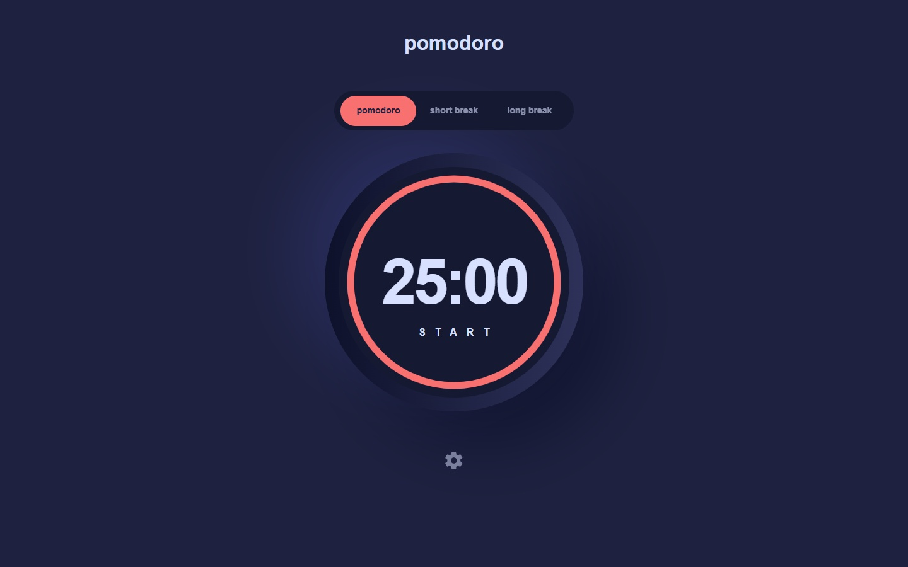

# Frontend Mentor - Pomodoro app solution

This is my solution to the Pomodoro app challenge on Frontend Mentor. It provides three timer modes, configurable durations, and font and accent color settings using HTML, CSS, and vanilla JavaScript.

## Overview

### The challenge

Users can:

- Switch between Pomodoro, short break, and long break timers.
- Start, pause, resume, and restart a timer.
- Set each timer duration to a whole number from 1 to 99 minutes.
- Follow the remaining time through a circular progress ring.
- Choose from three fonts and three accent colors.
- Use a responsive layout with visible keyboard focus indicators.

The default durations are 25 minutes for Pomodoro, 5 minutes for a short break, and 15 minutes for a long break. Switching to a different mode resets the timer. Settings remain in memory for the current page session and return to their defaults on reload.

### Screenshot



### Links

- Repository: [GitHub repository](https://github.com/jonghwascript/pomodoro-app)
- Live site: [Pomodoro app](https://jonghwascript.github.io/pomodoro-app/)

## My process

### Built with

- Semantic HTML, native buttons, radio inputs, and a modal dialog
- SVG for the circular progress ring
- CSS custom properties for fonts, colors, and spacing
- Flexbox and CSS Grid
- Mobile-first styles and container query units
- Sass modules, maps, and reusable mixins
- Vanilla JavaScript for timer state, rendering, and form validation

### What I learned

#### Connecting SVG progress to timer state

Normalizing the SVG path length lets JavaScript express progress as a value from 0 to 100 without calculating the circle's circumference.

```html
<circle cx="183" cy="183" r="164" pathLength="100" />
```

```css
.c-timer__bar {
  stroke-dasharray: var(--progress, 100) 100;
  stroke-linecap: round;
  transition: stroke-dasharray 1s linear;
}
```

```js
const ratio =
  timer.status === 'done' ? 1 : timer.remainingSeconds / timer.totalSeconds;
progressBar.style.setProperty('--progress', (ratio * 100).toFixed(3));
```

The ring shrinks as the remaining time decreases. At completion, it returns to a full ring while the display shows `00:00`. Rotating the SVG by `-90deg` places the starting point at the top. Rounded line caps slightly extend the visible ends of the stroke. Reduced motion styles shorten transitions to `0.01ms`.

#### Combining a native dialog with custom validation

The settings form uses native dialog submission:

```html
<form class="c-settings__panel js-settings-form" method="dialog" novalidate>
```

JavaScript validates all three durations before applying settings. Invalid input cancels submission with `event.preventDefault()`, keeping the dialog open. The form adds `aria-invalid`, connects the input to an error message through `aria-describedby`, and focuses the first invalid field.

A successful submission applies the settings, resets the current timer, and lets the browser close the dialog. Closing the dialog, including with Escape, returns focus to the settings button.

#### Separating time display from completion announcements

The changing time uses `role="timer"`. A separate visually hidden element uses `role="status"` and receives a message when the timer finishes. This keeps completion announcements separate from frequent time updates. Actual announcement behavior still requires screen reader testing.

#### Scaling text within the timer

The timer establishes an inline-size query container. Its time text, action text, and letter spacing use `cqi` units with `min()` limits, allowing them to scale with the timer diameter while retaining an upper bound.

The time also uses `font-variant-numeric: tabular-nums` to request equal-width digits. Its effect depends on support in the selected font.

#### Applying themes through CSS custom properties

JavaScript applies `is-font-*` and `is-color-*` classes to the body. Sass maps generate the corresponding rules, which update `--font-app` and `--color-accent`.

For example, the generated font rule is:

```css
body.is-font-roboto {
  --font-app: 'Roboto Slab', serif;
}
```

App text inherits the selected font or references the same custom property through component rules. Font preview swatches keep their individually assigned fonts. The available fonts are Kumbh Sans, Roboto Slab, and Space Mono; the accent colors are red, cyan, and purple.

CSS masks draw the settings, close, and arrow icons using `currentColor`. Forced color rules give those icons a system color. The `:has()` selector allows a swatch label to show an outline when its visually hidden radio input has keyboard focus.

#### Calculating time from an end timestamp

Instead of subtracting one second on every callback, the timer calculates the difference between its end timestamp and the current time.

```js
timer.endTime = Date.now() + timer.remainingMilliseconds;
timer.intervalId = setInterval(tick, 250);

// Inside tick():
timer.remainingMilliseconds = Math.max(0, timer.endTime - Date.now());
const left = Math.ceil(timer.remainingMilliseconds / 1000);
```

This accounts for elapsed time when callbacks are delayed. The 250ms interval controls how often the display is checked. Background throttling can still delay completion handling, and system clock changes affect `Date.now()`. The display rounds remaining seconds up so completion happens at or after the deadline. Pausing recalculates the remaining milliseconds at the moment of the click, and resuming uses that value to preserve fractions of a second.

Timer state is separated from rendering through `idle`, `running`, `paused`, and `done` states. `render()` updates the time, action label, and progress ring. Intervals are cleared when the timer pauses, resets, or finishes.

Browser regression tests cover countdown, repeated pause and resume, mode changes, completion and restart, delayed callbacks, invalid settings, and keyboard input. Run `npm test` with Google Chrome installed. The tests use Playwright's controlled clock and serve the source files with CSS compiled in memory, leaving `dist` unchanged.

#### Keeping draft settings separate from applied settings

Opening settings copies the current values into the form. Editing the form does not immediately change the app. Only a valid Apply submission updates the settings object. Closing and reopening the dialog discards unapplied changes.

Opening settings leaves a running timer active. Applying valid settings resets the current mode, even if its duration is unchanged.

Before applying theme classes, JavaScript copies the live class list into an array so that removing classes cannot skip entries during iteration.

```js
[...body.classList].forEach((name) => {
  if (name.startsWith('is-font-') || name.startsWith('is-color-')) {
    body.classList.remove(name);
  }
});
```

### Continued development

- Explore persisting applied settings with `localStorage`.
- Explore a monotonic clock to avoid the effect of system clock changes.
- Validate completion announcements with screen readers and inspect the interface in forced color mode.
- Continue checking responsive behavior, keyboard interactions, and text enlargement across browsers.
